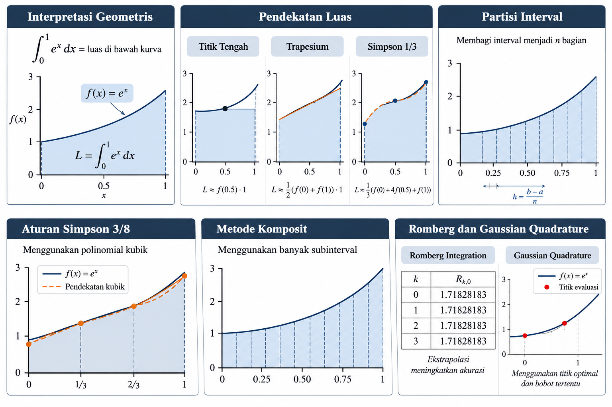

## Capaian Pembelajaran

Setelah perkuliahan, mahasiswa diharapkan mampu:

- menjelaskan gagasan dasar kuadratur numerik;
- menggunakan aturan titik tengah, trapesium, dan Simpson;
- menerapkan aturan komposit pada interval yang dibagi menjadi beberapa subinterval;
- menghitung dan menafsirkan galat pendekatan;
- mengimplementasikan metode integrasi numerik menggunakan R;
- membandingkan metode berdasarkan ketelitian dan jumlah evaluasi fungsi.

## Ilustrasi Integrasi Numerik

{width=80% fig-align="center"}

## Mengapa integrasi numerik? {.scrollable}

- Integral tentu

$$
I=\int_a^b f(x)\,dx
$$

- dapat dihitung secara analitik jika antiturunan $F(x)$ tersedia dan mudah diperoleh.

- Namun, dalam persoalan terapan:

   - antiturunan mungkin tidak memiliki bentuk elementer;
   - fungsi dapat diketahui hanya melalui tabel pengamatan;
   - evaluasi integral secara eksak mungkin tidak praktis;
   - diperlukan pendekatan numerik dengan ketelitian yang dapat dikendalikan.

- **Integrasi numerik** atau *numerical quadrature* mendekati integral dengan penjumlahan berbobot nilai fungsi.


## Interpretasi geometris {.scrollable}

Untuk $f(x)\geq 0$, integral tentu dapat dipandang sebagai luas daerah di bawah kurva pada interval $[a,b]$.

Pendekatan numerik membagi interval menjadi bagian-bagian kecil, kemudian mengganti kurva dengan bentuk sederhana.

Contoh bentuk pendekatan:

- persegi panjang pada aturan titik tengah;
- trapesium pada aturan trapesium;
- polinomial kuadratik pada aturan Simpson.


## Gagasan umum kuadratur {.scrollable}

Bentuk umum rumus kuadratur:

$$
\int_a^b f(x)\,dx
\approx
\sum_{i=0}^{n} A_i f(x_i),
$$

dengan:

- $x_i$: titik evaluasi atau *nodes*;
- $A_i$: bobot atau *weights*;
- $f(x_i)$: nilai fungsi pada titik tersebut.

Pertanyaan penting: bagaimana memilih titik $x_i$ dan bobot $A_i$ agar pendekatan akurat?


## Hubungan dengan interpolasi {.scrollable}

Salah satu cara membangun rumus kuadratur adalah:

1. memilih beberapa titik pada interval;
2. membentuk polinomial interpolasi yang mendekati $f(x)$;
3. mengintegralkan polinomial tersebut;
4. memperoleh kombinasi berbobot dari nilai-nilai fungsi.

Dengan demikian, integrasi numerik berkaitan erat dengan materi interpolasi Lagrange dan Newton.


## Aturan titik tengah {.scrollable}

Bagi interval $[a,b]$ menjadi satu bagian. Titik tengahnya:

$$
m=\frac{a+b}{2}.
$$

Luas daerah didekati oleh luas persegi panjang dengan lebar $b-a$ dan tinggi $f(m)$:

$$
\boxed{
\int_a^b f(x)\,dx
\approx (b-a)f\left(\frac{a+b}{2}\right)
}
$$

Aturan ini hanya memerlukan satu evaluasi fungsi.


## Aturan titik tengah: contoh {.scrollable}

Dekati integral

$$
I=\int_0^2 x^2\,dx
$$

menggunakan aturan titik tengah satu panel.

Titik tengah:

$$
m=\frac{0+2}{2}=1.
$$

Maka:

$$
I\approx (2-0)f(1)
=2(1^2)=2.
$$

Nilai eksak:

$$
I=\left[\frac{x^3}{3}\right]_0^2
=\frac{8}{3}\approx2.6667.
$$

Galat absolut:

$$
E=|2-2.6667|\approx0.6667.
$$


## Aturan trapesium {.scrollable}

Kurva didekati oleh garis yang menghubungkan titik \((a,f(a))\) dan \((b,f(b))\).

Luas trapesium memberikan:

$$
\boxed{
\int_a^b f(x)\,dx
\approx
\frac{b-a}{2}\left[f(a)+f(b)\right]
}
$$

Aturan ini menggunakan dua evaluasi fungsi, yaitu pada kedua ujung interval.


## Aturan trapesium: contoh {.scrollable}

Gunakan aturan trapesium untuk

$$
I=\int_0^2 x^2\,dx.
$$

Diketahui:

$$
f(0)=0,\qquad f(2)=4.
$$

Sehingga:

$$
I\approx \frac{2-0}{2}[0+4]=4.
$$

Nilai eksak adalah $8/3$. Jadi:

$$
E=\left|4-\frac83\right|=\frac43.
$$

Untuk fungsi cekung ke atas seperti $x^2$, pendekatan satu trapesium pada contoh ini menghasilkan nilai yang lebih besar daripada integral sebenarnya.


## Aturan Simpson 1/3 {.scrollable}

Simpson $1/3$ menggunakan tiga titik berjarak sama:

$$
x_0=a,\qquad x_1=a+h,\qquad x_2=b,
$$

dengan $h=(b-a)/2$.

Kurva didekati oleh polinomial kuadratik melalui ketiga titik tersebut.

$$
\boxed{
\int_a^b f(x)\,dx
\approx
\frac{h}{3}
[f(x_0)+4f(x_1)+f(x_2)]
}
$$

Bobotnya mengikuti pola $1,4,1$.


## Simpson 1/3: contoh {.scrollable}

Dekati

$$
I=\int_0^2 x^2\,dx.
$$

Titik-titiknya $x_0=0$, $x_1=1$, dan $x_2=2$, sehingga $h=1$.

$$
\begin{aligned}
I&\approx\frac{1}{3}
[f(0)+4f(1)+f(2)]\\
&=\frac13[0+4(1)+4]\\
&=\frac83.
\end{aligned}
$$

Hasilnya sama dengan nilai eksak. Simpson 1/3 tepat untuk polinomial berderajat sampai tiga.


## Derajat ketelitian (*degree of precision*) {.scrollable}

Derajat ketelitian adalah derajat tertinggi polinomial yang dapat diintegralkan secara tepat oleh suatu rumus kuadratur.

  | Metode satu panel | Derajat ketelitian |
  |---|---:|
  | Titik tengah | 1 |
  | Trapesium | 1 |
  | Simpson 1/3 | 3 |
  | Simpson 3/8 | 3 |

Derajat ketelitian membantu menjelaskan mengapa suatu metode menghasilkan nilai eksak untuk fungsi tertentu.


## Membandingkan tiga aturan {.scrollable}

Untuk $f(x)=x^2$ pada $[0,2]$:

   | Metode | Pendekatan | Nilai eksak |
   |---|---:|---:|
   | Titik tengah | 2.0000 | 2.6667 |
   | Trapesium | 4.0000 | 2.6667 |
   | Simpson 1/3 | 2.6667 | 2.6667 |

Satu contoh tidak cukup untuk menyimpulkan metode mana yang selalu terbaik. Ketelitian juga dipengaruhi bentuk fungsi, interval, dan jumlah subinterval.


## Implementasi aturan satu panel di R {.scrollable}

```{r}
f <- function(x) x^2

a <- 0
b <- 2

midpoint <- (b - a) * f((a + b) / 2)

trapezoid <- (b - a) / 2 * (f(a) + f(b))

h <- (b - a) / 2
simpson13 <- h / 3 * (f(a) + 4*f((a+b)/2) + f(b))

c(midpoint = midpoint,
  trapezoid = trapezoid,
  simpson13 = simpson13)
```


## Galat aturan trapesium {.scrollable}

Untuk $f$ yang memiliki turunan kedua kontinu, galat satu panel dapat ditulis:

$$
E_T=I-T
=-\frac{(b-a)^3}{12}f''(\xi),
$$

untuk suatu $\xi\in(a,b)$.

Implikasi:

- galat dipengaruhi kelengkungan fungsi;
- jika $f''(x)=0$, aturan trapesium tepat;
- semakin kecil panjang interval, galat satu panel umumnya semakin kecil.


## Galat Simpson 1/3

Jika turunan keempat kontinu, galat Simpson 1/3 satu panel adalah:

$$
E_S=I-S
=-\frac{h^5}{90}f^{(4)}(\xi),
$$

dengan $h=(b-a)/2$ dan $\xi\in(a,b)$.

Simpson $1/3$ tepat untuk polinomial berderajat paling tinggi tiga.

Galat bergantung pada turunan keempat, bukan hanya pada nilai fungsi di titik-titik evaluasi.


## Rumus terbuka dan tertutup Newton–Cotes {.scrollable}

Aturan trapesium dan Simpson termasuk keluarga rumus Newton–Cotes.

- **Tertutup (*closed*)**: titik ujung interval digunakan sebagai titik evaluasi.
- **Terbuka (*open*)**: titik evaluasi berada di bagian dalam interval, tidak mencakup kedua ujung.

Contoh tertutup: trapesium dan Simpson 1/3.

Dalam pertemuan ini, perhatian utama diberikan pada aturan tertutup karena lebih mudah dihubungkan dengan tabel data dan partisi interval.


## Mengapa aturan komposit diperlukan? {.scrollable}

Satu panel mungkin belum cukup mewakili bentuk kurva pada interval yang lebar.

Solusinya: bagi $[a,b]$ menjadi $n$ subinterval dengan lebar sama.

$$
h=\frac{b-a}{n},\qquad
x_i=a+ih.
$$

Setiap subinterval didekati secara terpisah, lalu seluruh luas pendekatan dijumlahkan.

Metode ini disebut aturan komposit.


## Aturan trapesium komposit {.scrollable}

Dengan $n$ subinterval:

$$
\boxed{
T_n=\frac{h}{2}
\left[
f(x_0)+2\sum_{i=1}^{n-1}f(x_i)+f(x_n)
\right]
}
$$

Pola bobot:

$$
1,\ 2,\ 2,\ldots,\ 2,\ 1.
$$

Galat komposit:

$$
E_T=-\frac{(b-a)}{12}h^2 f''(\xi).
$$

Orde galatnya $O(h^2)$.


## Trapesium komposit: contoh {.scrollable}

Dekati:

$$
I=\int_0^2 x^2\,dx
$$

dengan $n=4$.

$$
h=\frac{2-0}{4}=0.5.
$$

   | $i$ | $x_i$ | $f(x_i)=x_i^2$ |
   |---:|---:|---:|
   | 0 | 0.0 | 0.00 |
   | 1 | 0.5 | 0.25 |
   | 2 | 1.0 | 1.00 |
   | 3 | 1.5 | 2.25 |
   | 4 | 2.0 | 4.00 |

$$
T_4=\frac{0.5}{2}
[0+2(0.25+1+2.25)+4]
=2.75.
$$

Nilai eksak $=2.6667$.


## Implementasi trapesium komposit di R {.scrollable}

```{r}
trapezoid_comp <- function(f, a, b, n) {
  h <- (b - a) / n
  x <- seq(a, b, length.out = n + 1)
  y <- f(x)

  h/2 * (y[1] + 2*sum(y[2:n]) + y[n+1])
}

f <- function(x) x^2

trapezoid_comp(f, 0, 2, 4)
```

Perhatikan bahwa `y[2:n]` memuat nilai fungsi pada titik interior, sedangkan kedua ujung interval dihitung satu kali.


## Simpson $1/3$ komposit {.scrollable}

Untuk Simpson 1/3 komposit, jumlah subinterval $n$ harus genap.

$$
\boxed{
S_n=\frac{h}{3}
\left[
f(x_0)
+4\sum_{\text{indeks ganjil}}f(x_i)
+2\sum_{\substack{\text{indeks genap}\\0<i<n}}f(x_i)
+f(x_n)
\right]
}
$$

Pola bobot:

$$
1,\ 4,\ 2,\ 4,\ 2,\ldots,\ 4,\ 1.
$$

Galat komposit:

$$
E_S=-\frac{(b-a)}{180}h^4 f^{(4)}(\xi).
$$

Orde galatnya $O(h^4)$.


## Simpson 1/3 komposit: contoh {.scrollable}

Untuk $\int_0^2 x^2\,dx$, gunakan $n=4$ dan $h=0.5$.

$$
\begin{aligned}
S_4=\frac{0.5}{3}[&
f(0)+4f(0.5)+2f(1)\\
&+4f(1.5)+f(2)].
\end{aligned}
$$

$$
S_4=\frac{0.5}{3}
[0+1+2+9+4]
=\frac83.
$$

Hasil ini tepat karena fungsi yang digunakan adalah polinomial kuadratik.


## Implementasi Simpson $1/3$ komposit di R {.scrollable}

```{r}
simpson13_comp <- function(f, a, b, n) {

  if (n <= 0 || n %% 2 != 0) {
    stop("n harus berupa bilangan bulat positif dan genap.")
  }

  h <- (b - a) / n
  x <- seq(a, b, length.out = n + 1)

  sum_odd <- sum(f(x[seq(2, n, by = 2)]))

  sum_even <- if (n >= 4) {
    sum(f(x[seq(3, n - 1, by = 2)]))
  } else {
    0
  }

  (h / 3) * (
    f(a) + f(b) +
    4 * sum_odd +
    2 * sum_even
  )
}
```

Ingat: indeks R dimulai dari 1, sedangkan notasi matematika biasanya dimulai dari $x_0$.


## Simpson 3/8 {.scrollable}

Simpson 3/8 menggunakan empat titik yang membentuk tiga subinterval sama panjang.

$$
\boxed{
\int_{x_0}^{x_3}f(x)\,dx
\approx
\frac{3h}{8}
[f(x_0)+3f(x_1)+3f(x_2)+f(x_3)]
}
$$

Untuk aturan komposit, $n$ harus merupakan kelipatan tiga.

Pola bobot komposit:

$$
1,\ 3,\ 3,\ 2,\ 3,\ 3,\ 2,\ldots,\ 3,\ 3,\ 1.
$$

Simpson 3/8 juga memiliki derajat ketelitian tiga.


## Simpson 3/8: contoh {.scrollable}

Hitung:

$$
I=\int_0^3 x^3\,dx
$$

dengan satu panel Simpson 3/8.

Di sini $h=1$, dan:

$$
f(0)=0,\quad f(1)=1,\quad
f(2)=8,\quad f(3)=27.
$$

$$
\begin{aligned}
I&\approx\frac{3}{8}[0+3(1)+3(8)+27]\\
&=\frac38(54)=20.25.
\end{aligned}
$$

Nilai eksak:

$$
\int_0^3x^3\,dx=\frac{3^4}{4}=20.25.
$$


## Implementasi Simpson 3/8 komposit di R {.scrollable}

```{r}
simpson38_comp <- function(f, a, b, n) {
  if (n %% 3 != 0) {
    stop("n harus kelipatan 3.")
  }

  h <- (b - a) / n
  x <- seq(a, b, length.out = n + 1)
  y <- f(x)

  idx3 <- seq(2, n, by = 3)
  idx2 <- seq(3, n, by = 3)

  3*h/8 * (y[1] + 3*sum(y[idx3]) +
           2*sum(y[idx2]) + y[n+1])
}

f <- function(x) x^3
simpson38_comp(f, 0, 3, 3)
```


## Memilih jumlah subinterval {.scrollable}

Syarat jumlah subinterval:

  | Metode | Ketentuan $n$ |
  |---|---|
  | Titik tengah komposit | bilangan bulat positif |
  | Trapesium komposit | bilangan bulat positif |
  | Simpson 1/3 komposit | genap |
  | Simpson 3/8 komposit | kelipatan 3 |

Jika ingin membandingkan metode dengan jumlah subinterval sama, pilih \(n\) yang memenuhi syarat metode yang dibandingkan, misalnya $n=6$.


## Perbandingan orde galat {.scrollable}

 | Metode komposit | Orde galat global |
 |---|---:|
 | Titik tengah | $O(h^2)$ |
 | Trapesium | $O(h^2)$ |
 | Simpson 1/3 | $O(h^4)$ |
 | Simpson 3/8 | $O(h^4)$ |

Untuk fungsi yang cukup mulus, galat Simpson umumnya berkurang lebih cepat ketika \(h\) diperkecil.

Orde galat bukan jaminan bahwa satu metode selalu unggul untuk setiap fungsi dan setiap partisi.


## Eksperimen: pengaruh jumlah subinterval {.scrollable}

Gunakan:

$$
I=\int_0^1 e^x\,dx=e-1.
$$

Bandingkan aturan trapesium dan Simpson 1/3 untuk beberapa nilai \(n\).

```{r}
f <- function(x) exp(x)
exact <- exp(1) - 1

n_values <- c(2, 4, 6, 8, 10, 20)

comparison <- data.frame(
  n = n_values,
  Trapezoid = sapply(
    n_values, function(n) trapezoid_comp(f, 0, 1, n)
  ),
  Simpson = sapply(
    n_values, function(n) simpson13_comp(f, 0, 1, n)
  )
)

comparison$Error_T <- abs(comparison$Trapezoid - exact)
comparison$Error_S <- abs(comparison$Simpson - exact)

comparison
```


## Visualisasi perubahan galat {.scrollable}

```{r}
plot(comparison$n, comparison$Error_T,
     type = "b", log = "y",
     xlab = "Jumlah subinterval (n)",
     ylab = "Galat absolut",
     main = "Perbandingan galat integrasi")

lines(comparison$n, comparison$Error_S,
      type = "b", lty = 2)

legend("topright",
       legend = c("Trapesium", "Simpson 1/3"),
       lty = c(1, 2), pch = 1)
```

Diskusikan:

- apakah galat menurun ketika $n$ meningkat?
- metode mana yang lebih cepat menurunkan galat?
- mengapa grafik menggunakan skala logaritmik?


## Integrasi ketika hanya tersedia data {.scrollable}

Tidak semua persoalan memberikan fungsi $f(x)$ dalam bentuk eksplisit.

Kadang-kadang hanya tersedia pasangan data:

$$
(x_0,y_0),\ (x_1,y_1),\ldots,(x_n,y_n).
$$

Jika jarak antar titik sama, aturan komposit dapat diterapkan dengan mengganti $f(x_i)$ oleh $y_i$.

Contoh penggunaan:

- total akumulasi curah hujan dari laju hujan;
- jarak tempuh dari data kecepatan terhadap waktu;
- luas di bawah kurva hasil pengukuran;
- akumulasi perubahan suatu besaran.


## Contoh integrasi dari tabel data {.scrollable}

Misalkan data kecepatan kendaraan terhadap waktu tersedia sebagai berikut.

  | Waktu (detik) | Kecepatan (m/s) |
  |---:|---:|
  | 0 | 0 |
  | 1 | 2 |
  | 2 | 4 |
| 3 | 5 |
| 4 | 4 |

Jarak tempuh selama empat detik dapat diperkirakan melalui:

$$
s=\int_0^4 v(t)\,dt.
$$

Karena tersedia lima titik berjarak sama, aturan trapesium komposit dapat digunakan.

$$
s\approx\frac{1}{2}
[0+2(2+4+5)+4]=12.
$$

Satuan hasil adalah meter.


## Romberg integration: gagasan {.scrollable}

Romberg integration meningkatkan ketelitian aturan trapesium komposit dengan menggunakan beberapa ukuran langkah.

Gagasan utamanya:

1. hitung pendekatan trapesium dengan langkah $h$;
2. hitung kembali dengan langkah $h/2$;
3. kombinasikan hasil-hasil tersebut melalui ekstrapolasi Richardson;
4. ulangi untuk memperoleh pendekatan yang lebih akurat.

Ekstrapolasi pertama:

$$
R_{2,2}
=
\frac{4T(h/2)-T(h)}{3}.
$$

Metode ini memanfaatkan pola galat aturan trapesium, bukan sekadar menambah titik secara langsung.


## Gaussian quadrature: gagasan {.scrollable}

Aturan Newton–Cotes umumnya menggunakan titik yang berjarak sama.

Gaussian quadrature memilih titik evaluasi dan bobot secara khusus agar suatu rumus dengan $n$ titik tepat untuk polinomial hingga derajat $2n-1$.

Bentuk umum pada interval standar:

$$
\int_{-1}^{1}f(x)\,dx
\approx
\sum_{i=1}^{n}w_i f(x_i).
$$

Keunggulannya: ketelitian tinggi dapat dicapai dengan jumlah evaluasi fungsi yang relatif sedikit.


## Gaussian quadrature dua titik {.scrollable}

Untuk interval $[-1,1]$, aturan Gauss-Legendre dua titik adalah:

$$
\boxed{
\int_{-1}^{1}f(x)\,dx
\approx
f\left(-\frac{1}{\sqrt3}\right)
+
f\left(\frac{1}{\sqrt3}\right)
}
$$

Rumus ini tepat untuk polinomial hingga derajat tiga.

Untuk interval umum $[a,b]$, lakukan transformasi:

$$
x=\frac{a+b}{2}+\frac{b-a}{2}t.
$$

Sehingga:

$$
\int_a^b f(x)\,dx
=
\frac{b-a}{2}
\int_{-1}^{1}
f\left(\frac{a+b}{2}+\frac{b-a}{2}t\right)dt.
$$


## Adaptive quadrature: gagasan {.scrollable}

Bagaimana jika fungsi berubah sangat cepat hanya pada bagian tertentu?

Menggunakan ukuran langkah yang sama di seluruh interval dapat menjadi tidak efisien.

*Adaptive quadrature* menyesuaikan pembagian interval berdasarkan perkiraan galat lokal:

- interval dengan galat kecil tidak perlu terus dibagi;
- interval dengan galat besar dibagi menjadi bagian lebih kecil;
- proses dihentikan ketika kriteria toleransi terpenuhi.

Pendekatan adaptif berguna untuk fungsi yang berosilasi atau memiliki perubahan lokal yang tajam.


## Menggunakan fungsi integrasi R {.scrollable}

R menyediakan fungsi `integrate()` untuk integrasi numerik fungsi satu variabel.

```{r}
f <- function(x) exp(-x^2)

integrate(f, lower = 0, upper = 1)
```

Hasil `integrate()` mencakup:

- nilai pendekatan integral;
- estimasi galat absolut;
- jumlah evaluasi fungsi;
- informasi keberhasilan proses.

Fungsi ini menggunakan prosedur kuadratur adaptif, sehingga hasilnya tidak harus sama dengan aturan komposit sederhana yang kita implementasikan sendiri.


## Membandingkan metode buatan sendiri dan `integrate()` {.scrollable}

```{r}
f <- function(x) exp(-x^2)

trap <- trapezoid_comp(f, 0, 1, 20)
simp <- simpson13_comp(f, 0, 1, 20)
adaptive <- integrate(f, 0, 1)

data.frame(
  Method = c("Trapesium", "Simpson 1/3", "integrate()"),
  Approximation = c(trap, simp, adaptive$value),
  Error_estimate = c(NA, NA, adaptive$abs.error)
)
```

Nilai `abs.error` dari `integrate()` merupakan estimasi galat algoritma, bukan nilai galat eksak yang diketahui dari antiturunan.


## Ringkasan metode {.scrollable}

  | Metode | Ide pendekatan | Karakteristik |
  |---|---|---|
  | Titik tengah | Persegi panjang | Satu titik di tengah panel |
  | Trapesium | Garis lurus | Menggunakan kedua ujung |
  | Simpson 1/3 | Polinomial kuadratik | $n$ genap untuk komposit |
  | Simpson 3/8 | Polinomial kubik | $n$ kelipatan 3 |
  | Romberg | Ekstrapolasi | Memanfaatkan trapesium bertingkat |
  | Gaussian | Titik dan bobot optimal | Efisien untuk fungsi mulus |
  | Adaptif | Partisi berdasarkan galat | Langkah dapat berbeda |


## Alur penyelesaian masalah {.scrollable}

Ketika menghadapi persoalan integrasi numerik:

1. tentukan fungsi atau tabel data;
2. tentukan batas integrasi;
3. periksa karakteristik fungsi dan data;
4. pilih metode;
5. tentukan jumlah subinterval atau titik evaluasi;
6. hitung pendekatan;
7. evaluasi galat jika nilai acuan tersedia;
8. interpretasikan hasil dalam konteks persoalan.


## Latihan kelas: perhitungan manual {.scrollable}

Hitung pendekatan integral berikut:

$$
I=\int_0^2 (x^3+1)\,dx.
$$

Gunakan:

- aturan titik tengah satu panel;
- aturan trapesium satu panel;
- Simpson 1/3 satu panel.

Tentukan pula nilai eksaknya dan galat absolut setiap metode.

**Diskusi:** metode mana yang tepat untuk fungsi ini? Jelaskan berdasarkan derajat ketelitian.


## Latihan kelas: aturan komposit {.scrollable}

Hitung:

$$
I=\int_0^1 \frac{1}{1+x^2}\,dx.
$$

Gunakan:

- trapesium komposit dengan $n=4$;
- Simpson 1/3 komposit dengan $n=4$;
- Simpson 3/8 komposit dengan $n=3$.

Bandingkan hasil dengan nilai eksak:

$$
I=\frac{\pi}{4}.
$$

Laporkan nilai pendekatan dan galat absolut.


## Latihan pemrograman R {.scrollable}

Buat tiga fungsi R:

```r
midpoint_comp <- function(f, a, b, n) {
  # lengkapi algoritma
}

trapezoid_comp <- function(f, a, b, n) {
  # lengkapi algoritma
}

simpson13_comp <- function(f, a, b, n) {
  # lengkapi algoritma
}
```

Ketentuan:

- fungsi menerima argumen `f`, `a`, `b`, dan `n`;
- periksa syarat jumlah subinterval;
- kembalikan satu nilai pendekatan integral;
- uji pada fungsi polinomial, eksponensial, dan trigonometri.


## Tugas analisis {.scrollable}

Gunakan fungsi:

$$
f(x)=e^{-x^2},\qquad 0\leq x\leq1.
$$

1. Hitung integral menggunakan trapesium dan Simpson 1/3.
2. Gunakan $n=2,4,6,10,20,40$.
3. Bandingkan hasil dengan `integrate()` di R.
4. Buat grafik galat terhadap jumlah subinterval.
5. Jelaskan metode mana yang lebih efisien untuk fungsi tersebut.

Sampaikan hasil dalam tabel dan uraian singkat.


## Hal yang perlu diingat

- Integrasi numerik merupakan pendekatan berbobot terhadap nilai fungsi.
- Aturan trapesium dan Simpson dapat diturunkan melalui interpolasi.
- Aturan komposit memperbaiki pendekatan dengan membagi interval.
- Orde galat memberi informasi tentang laju penurunan galat saat $h$ diperkecil.
- Pemilihan metode perlu mempertimbangkan bentuk fungsi, ketersediaan data, dan ketelitian yang dibutuhkan.


## Referensi

Burden, R. L., & Faires, J. D. (2011). *Numerical Analysis* (9th ed.). Brooks/Cole, Cengage Learning.

**Bagian yang menjadi acuan utama:** Chapter 4, khususnya Section 4.3 *Elements of Numerical Integration*, Section 4.4 *Composite Numerical Integration*, serta pengantar Section 4.5–4.7 mengenai Romberg integration, Gaussian quadrature, dan adaptive quadrature.

Materi disusun ulang dan disesuaikan untuk perkuliahan Metode Numerik pada mahasiswa Tadris Matematika.
